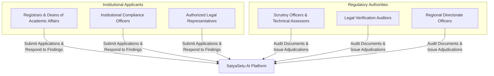
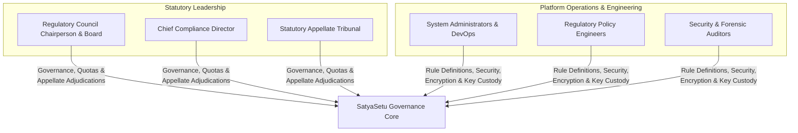
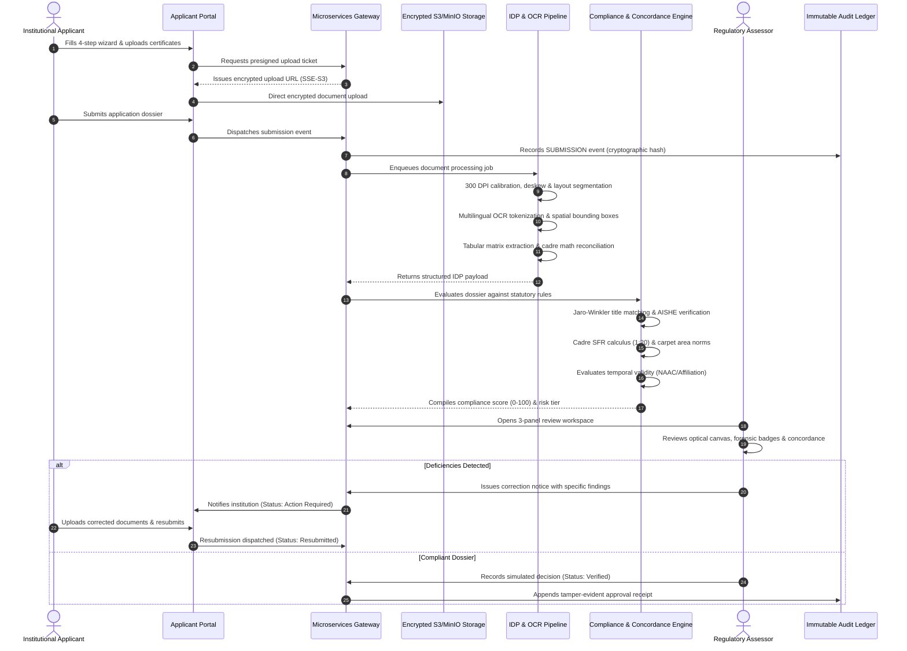

# SatyaSetu AI: Enterprise Platform Dossier
## AI-Powered Regulatory Application Validation, Document Authentication & Statutory Compliance Platform

---

## 1. Executive Summary & Purpose

### 1.1 What SatyaSetu AI Is
**SatyaSetu AI** is an enterprise-grade regulatory compliance verification and intelligent document authentication platform engineered for national regulatory councils, accreditation directorates, and higher education institutions (universities, autonomous engineering colleges, management institutes, and polytechnics).

The platform transforms paper-heavy, manual statutory evaluation processes into a streamlined, automated, and mathematically verifiable digital workflow. It combines **Intelligent Document Processing (IDP)**, **multilingual Optical Character Recognition (OCR)**, **spatial layout decomposition**, and a **deterministic statutory compliance rule engine** to cross-examine institutional submissions against official state gazette records, national directories, and regulatory standards (such as AICTE, UGC, and State Technical Board norms).

### 1.2 Core Problem Statement
Higher education regulatory bodies process tens of thousands of complex institutional filings annually for:
- Extension of Approval (EoA) and annual renewal of autonomy.
- New program sanctions and student intake capacity expansion.
- Infrastructure and faculty cadre compliance audits.
- Accreditation validation and statutory charter verification.

Historically, this evaluation has suffered from critical bottlenecks:
1. **Administrative Delays**: Manual scrutiny of hundreds of pages of certificates, blueprints, and faculty rosters takes months.
2. **Human Subjectivity & Inconsistency**: Discrepant interpretations of cadre ratios, land norms, and expiration windows across different regional scrutiny committees.
3. **Document Tampering & Fraud**: Altered intake figures, forged municipal approval seals, recycled faculty rosters across multiple colleges, and expired affiliation orders.
4. **Opaque Remediation Loops**: Institutions lack real-time visibility into specific deficiencies, resulting in redundant appeals and prolonged legal friction.

### 1.3 The SatyaSetu AI Solution
SatyaSetu AI bridges institutional applicants and statutory authorities by providing:
- **Instant Ingestion & Verification**: Automatic DPI calibration, deskew alignment, and token-level OCR extraction with spatial bounding boxes.
- **Mathematical Roster & Space Calculus**: Deterministic validation ensuring Student-to-Faculty Ratios (SFR $\le 1:20$) and instructional carpet areas ($\ge 4.5\text{ sq.m/student}$) satisfy statutory ceilings.
- **Concordance Cross-Referencing**: Multi-metric string similarity (Jaro-Winkler, Levenshtein, TokenSort) that cross-examines declared application titles against state gazette charters.
- **3-Panel Review Workspace**: A high-density assessor canvas pairing the raw document, forensic authenticity ribbons, and entity concordance inspectors.
- **Transparent Remediation Loop**: Structured objection dispatches allowing applicants to rectify flagged items with verifiable audit trails.

---

## 2. Target Users & Stakeholders (Who Will Use It)

SatyaSetu AI is architected with role-separated operational views tailored to distinct user personas across the regulatory ecosystem.



### 2.1 Institutional Applicants
* **Registrars & University Directors**: Submit comprehensive annual institutional filings, track approval lifecycles in real time, and digitally certify legal declarations.
* **Deans of Academic Affairs & HR Heads**: Manage and upload statutory faculty cadre rosters, Ph.D. rosters, and student enrollment datasets.
* **Campus Architects & Estate Officers**: Upload municipal architectural blueprints, fire safety certificates, and land title encumbrance documents.
* **Institutional Compliance Officers**: Monitor discrepancy notices, review assessor-flagged findings, upload replacement certificates, and provide formal clarifications.

### 2.2 Regulatory Scrutiny Officers & Technical Assessors
* **Scrutiny Committee Officers**: Perform first-tier triage on incoming submissions, verifying mandatory document completeness.
* **Technical & Engineering Division Assessors**: Review engineering and technical program specifications, laboratory computing node counts, and Student-to-Faculty Ratios.
* **Legal & Accreditation Verifiers**: Cross-examine state university acts, gazette notifications, and NAAC/NBA accreditation cycles.
* **Regional Directorate Evaluators**: Conduct expedited digital audits for Extension of Approval (EoA) filings.

---

## 3. Governance & Administration (Who Will Manage It)



### 3.1 Statutory Leadership & Executive Directorate
* **Council Chairpersons & Board Members**: Oversee national higher-education throughput, monitor institutional clearance rates, and review macroeconomic compliance analytics.
* **Chief Compliance Directors**: Establish regulatory review quotas, manage reviewer assignments, and resolve escalated discrepancy conflicts.
* **Statutory Appellate Authority**: Adjudicate formal institutional appeals against rejected applications with full access to chronological decision trails.

### 3.2 Platform Operations & Policy Architects
* **Regulatory Policy Engineers**: Define and update machine-evaluable statutory rules in the compliance engine (e.g., updating AICTE Approval Process Handbook clauses or UGC regulations).
* **System Administrators & DevOps Engineers**: Oversee multi-region Kubernetes clusters, Redis caching tiers, PostgreSQL replication, and S3/MinIO encrypted storage buckets.
* **Security & Forensic Auditors**: Inspect immutable audit ledgers, monitor tamper probability logs, and manage cryptographic signature keys.

---

## 4. System Architecture & End-to-End Workflow (How It Works)

SatyaSetu AI operates through a 6-stage lifecycle that takes an application from initial draft preparation through automated extraction, cross-referencing, human assessor scrutiny, and finalized decision recording.



### Detailed Breakdown of Workflow Stages:

#### Stage 1: Application Ingestion & Encrypted Storage
1. The applicant enters the **Institutional Portal** and initializes a multi-step filing.
2. The browser generates SHA-256 checksums and performs client-side MIME validation (PDF, JPEG, PNG $\le 10\text{ MB}$).
3. The platform issues an encrypted upload ticket with pre-signed authorization to write directly to S3/MinIO object storage with Server-Side Encryption (`AES256` / `aws:kms`).
4. Upon formal submission, the application is assigned a unique tracking identifier (e.g., `PRM-2026-1001`), locked from further client tampering, and logged into the immutable audit trail.

#### Stage 2: Optical Calibration & Layout Decomposition
1. Ingestion triggers the **Document Preprocessor** ([`preprocessor.ts`](file:///home/deepin/SatyaSetu/server/src/idp/preprocessor.ts)).
2. Scans are evaluated for resolution; low-DPI scans are automatically calibrated to a 300 DPI target standard.
3. Geometric skew angles ($-1.5^\circ$ to $+1.5^\circ$) are calculated and corrected.
4. The document is segmented into semantic layout blocks: Gazette Titles, Seal/Stamp Zones, Signature Blocks, Tabular Roster Grids, and Notary Blocks.

#### Stage 3: Intelligent Multilingual OCR & Tabular Parsing
1. The **Multilingual OCR Engine** ([`ocrEngine.ts`](file:///home/deepin/SatyaSetu/server/src/idp/ocrEngine.ts)) performs optical character recognition, deriving normalized spatial coordinates (`x, y, width, height`) and token-level confidence scores.
2. The **Tabular Matrix Parser** ([`tableParser.ts`](file:///home/deepin/SatyaSetu/server/src/idp/tableParser.ts)) extracts structured faculty and infrastructure matrices.
3. The parser executes **automated mathematical reconciliation**:
   - Computes row and column sums for teaching cadres (Professors + Associate Professors + Assistant Professors).
   - Validates that declared sums reconcile 100% with the full roster.
4. The **Key-Value Entity Extractor** ([`kvpExtractor.ts`](file:///home/deepin/SatyaSetu/server/src/idp/kvpExtractor.ts)) derives standardized regulatory parameters (AISHE code, charter number, affiliation validity, accreditation tier, student intake capacity).

#### Stage 4: Deterministic Compliance & Concordance Verification
1. The **String Similarity Engine** ([`stringSimilarity.ts`](file:///home/deepin/SatyaSetu/server/src/compliance/stringSimilarity.ts)) executes multi-metric lexical analysis:
   - Evaluates Jaro-Winkler similarity, normalized Levenshtein distance, and token sort ratio.
   - Detects name permutations (e.g. `"National Institute of Technology Karnataka (Surathkal)"` vs. `"Karnataka National Institute of Technology Surathkal"`).
2. The **Concordance Matcher** ([`concordanceMatcher.ts`](file:///home/deepin/SatyaSetu/server/src/compliance/concordanceMatcher.ts)) cross-references declared application attributes against extracted IDP entities and statutory registries.
3. The **Temporal Lifecycle Validator** ([`temporalValidator.ts`](file:///home/deepin/SatyaSetu/server/src/compliance/temporalValidator.ts)) validates expiration thresholds against the current academic filing year (`2026-2027`).
4. The **Statutory Calculus** ([`statutoryCalculus.ts`](file:///home/deepin/SatyaSetu/server/src/compliance/statutoryCalculus.ts)) checks:
   - **Student-to-Faculty Ratio (SFR)** against the AICTE $\le 1:20$ ceiling.
   - **Cadre Proportionality**: 1 Professor : 2 Associate Professors : 6 Assistant Professors.
   - **Instructional Carpet Area**: $\ge 4.5\text{ sq.m}$ per enrolled student.
5. The **Pluggable Rule Engine** ([`ruleEngine.ts`](file:///home/deepin/SatyaSetu/server/src/compliance/ruleEngine.ts)) applies 9 declarative statutory rules, compiling a quantitative compliance score ($0 - 100$) and a deterministic risk tier (`Low`, `Medium`, `High`).

#### Stage 5: Assessor 3-Panel Inspection Workspace
1. Regulatory assessors open the submitted dossier in the **3-Panel Review Workspace**:
   - **Left Panel (Dossier Checklist)**: Chronological status, document completion flags, and finding badges.
   - **Center Panel (Document Canvas)**: High-resolution document viewer with forensic seal markers, zoom/rotation controls, and extracted OCR overlays.
   - **Right Panel (Concordance Inspector)**: Field-by-field side-by-side comparison of declared vs extracted values, confidence scores, and rule findings.
2. Reviewers can request structured corrections with specific deadlines and comments, transitioning the application into `Action Required`.

#### Stage 6: Bidirectional Remediation & Final Adjudication
1. When an application is in `Action Required`, the institutional portal activates the remediation interface.
2. The applicant reviews assessor remarks, uploads replacement documents, submits explanatory statements, and clicks **Resubmit Application**.
3. The dossier transitions to `Resubmitted` and returns to the top of the assessor's priority review queue.
4. When all criteria are satisfied, the administrator records the official decision (`Verified` or `Rejected`), triggering an immutable compliance receipt.

---

## 5. Development Roadmap: The 10 Phases

The engineering lifecycle of SatyaSetu AI is structured into 10 cohesive phases. Phases 1 through 7 are fully implemented, tested, and operational.

```mermaid
flowchart LR
    P1["1. Requirements & Norms (Done)"] --> P2["2. Interactive Frontend (Done)"]
    P2 --> P3["3. Backend Microservices (Done)"]
    P3 --> P4["4. OCR & IDP Pipeline (Done)"]
    P4 --> P5["5. Compliance Engine (Done)"]
    P5 --> P6["6. Identity & Security (Done)"]
    P6 --> P7["7. Forensics & Anti-Fraud (Done)"]
    P7 --> P8["8. Workflow Orchestration"]
    P8 --> P9["9. Audit & Reporting"]
    P9 --> P10["10. Scale & Go-Live"]
```



### Phase 1: Requirements Engineering, Regulatory Mapping & Statutory Formalization
* **Status**: Completed
* **Core Focus**: Translating statutory accreditation and approval process norms into machine-evaluable specifications.
* **Key Deliverables**:
  - Codification of statutory criteria (AICTE Approval Process Handbook, UGC Regulations, State Affiliation criteria).
  - Formalization of statutory document taxonomies (Charter Deeds, Affiliation Orders, Land Blueprints, Cadre Rosters).
  - Specification of concordance thresholds, discrepancy severities, and remediation workflows.

### Phase 2: Design System, UX Architecture & Interactive Frontend
* **Status**: Completed
* **Core Focus**: Premium, accessible, high-trust institutional user experience.
* **Key Deliverables**:
  - **Dual-Persona Interface**: Applicant Portal (`/applicant/*`) and Admin Verification Console (`/admin/*`).
  - **3-Panel Optical Review Workspace**: Integrated checklist, document inspection canvas with forensic markers, and concordance inspector.
  - **4-Step Application Creation Wizard**: Multi-step submission form with client-side file inspection and size/type validation.
  - **Bidirectional Remediation Loop**: Interactive correction requests, applicant response submission, and re-review workflows.
  - React 18, TypeScript strict typing, Tailwind CSS, Lucide icons, and Recharts analytics.

### Phase 3: Domain Data Modeling & Core Microservices Backend Foundation
* **Status**: Completed
* **Core Focus**: Horizontally scalable, enterprise backend architecture.
* **Key Deliverables**:
  - **PostgreSQL Relational Schema**: Normalized schema with UUID primary keys, GIN indexing on JSONB metadata, foreign key constraints, and immutable audit triggers.
  - **Encrypted S3 / MinIO Object Storage**: Presigned upload and download generators with Server-Side Encryption (`AES256` / `aws:kms`), SHA-256 integrity checks, and MIME restrictions.
  - **Distributed Redis Cache & Locks**: Cache-aside layer, distributed review locks preventing concurrent assessor collisions, and rate limiters.
  - **Dual Gateway Architecture**: REST API Gateway with RFC 7807 error envelopes and high-throughput GraphQL Gateway.
  - **Interactive OpenAPI 3.1 Explorer**: Swagger UI served interactively at `/api-docs`.

### Phase 4: Intelligent Document Processing (IDP) & Multilingual OCR Pipeline
* **Status**: Completed
* **Core Focus**: Automated text extraction, spatial bounding box derivation, and tabular roster parsing.
* **Key Deliverables**:
  - **Document Preprocessor**: Automatic 300 DPI calibration, geometric deskew alignment, adaptive contrast thresholding, and layout decomposition into 6 statutory zones.
  - **Multilingual OCR Engine**: Token-level optical extraction with normalized spatial coordinates (`x, y, width, height`) and confidence metrics.
  - **Tabular Matrix Parser**: Structural extraction of faculty rosters and infrastructure carpet areas with mathematical cadre sum verification.
  - **Key-Value Entity Extractor**: Targeted statutory entity extraction for AISHE codes, charter numbers, and accreditation standing.
  - **Asynchronous IDP Queue**: Redis-backed stage progression state machine (`QUEUED` $\to$ `PREPROCESSING` $\to$ `EXTRACTING_OCR` $\to$ `PARSING_TABLES` $\to$ `EXTRACTING_ENTITIES` $\to$ `COMPLETED`).

### Phase 5: Deterministic Compliance Verification & Concordance Engine
* **Status**: Completed
* **Core Focus**: Real-time cross-referencing between extracted data and statutory requirements, deterministic rule evaluation, and automated risk scoring.
* **Key Deliverables**:
  - **String Similarity Engine**: Levenshtein distance, Jaro-Winkler with prefix scaling, and token sort ratio accommodating institutional name permutations.
  - **Multi-Field Concordance Matcher**: Automated cross-validation comparing declared application attributes against extracted IDP entities.
  - **Temporal Lifecycle Engine**: Evaluates university affiliation continuity and NAAC/NBA accreditation cycles against current academic filing periods.
  - **Statutory Calculus**: Deterministic verification of Student-to-Faculty Ratios (AICTE SFR $\le 1:20$ ceiling) and minimum instructional carpet area ($\ge 4.5\text{ sq.m/student}$).
  - **Pluggable Rule Engine & Discrepancy Triage**: 9 declarative statutory rules across Concordance, Temporal, Cadre, Infrastructure, and Statutory Legal categories, computing a 0-100 compliance score, risk tier (`Low`, `Medium`, `High`), and automated remediation advice.

### Phase 6: Institutional Identity, Statutory Integrations & Security Hardening
* **Status**: Completed
* **Core Focus**: Trust infrastructure, Single Sign-On (SSO), Multi-Factor Authentication (MFA), and statutory government repository bridges.
* **Key Deliverables**:
  - Cryptographic JWT access token signing (HS256), refresh token rotation, and active blacklist revocation (`JwtService`).
  - RFC 6238 TOTP Multi-Factor Authentication with 160-bit Base32 secret generation, dynamic truncation, and emergency backup codes (`TotpService`).
  - OAuth 2.0 / OpenID Connect with PKCE (`S256` SHA-256 challenge) for secure institutional login federation.
  - Role-Based Access Control (RBAC) with fine-grained scoping across Applicant, Scrutiny, Assessor, Director, and Admin tiers (`RbacService`).
  - National DigiLocker API Adapter (`DigiLockerService`) providing DPDP consent-driven retrieval of charters, affiliation orders, and NAAC accreditations with PKI verification.
  - Aadhaar eSign & DSC Verification Engine (`AadhaarESignService`) under IT Act 2000 Section 3A, establishing non-repudiation and X.509 certificate chains from CCA India.
  - Ministry of Education AISHE & NAD registry synchronization (`NadAisheSyncService`) validating sanctioned intake limits, accredited program counts, and institutional standing.

### Phase 7: Document Forensics, Anti-Fraud & Visual Integrity Analysis
* **Status**: Completed
* **Core Focus**: Detecting digital tampering, visual anomalies, cloned stamps, and forged seals.
* **Key Deliverables**:
  - **Error Level Analysis (ELA)**: Localized compression variance and quantization error residual analysis (`ElaAnalyzer`) evaluating JPEG/PNG grids to detect digitally spliced text, altered approval dates, and pasted signature overlays.
  - **Copy-Move Forgery Detection (CMFD)**: Keypoint feature extraction and spatial correlation matching (`CmfdAnalyzer`) identifying duplicated institutional stamps, cloned registrar signatures, and repeated seal impressions across document pages.
  - **PDF Structural Revision Tree Inspector**: Stream parser (`PdfStructureInspector`) detecting incremental revisions (`%%EOF` marker chaining), overlaid white vector rectangles concealing original text, and graphic design software editing footprints (Photoshop, Canva, Illustrator on statutory gazettes).
  - **Perceptual Document Hashing (dHash & aHash)**: 64-bit gradient difference fingerprinting engine (`PerceptualHashEngine`) with Hamming distance thresholds ($\le 4$ bits) and cross-institutional document registry detecting recycled blueprints, duplicate land records, and cross-application document fraud.
  - **Unified Forensic Service**: High-level orchestration facade (`ForensicService`) computing a holistic tamper likelihood score ($0.00 - 1.00$), classifying risk tiers (`Low`, `Medium`, `High`, `Critical`), extracting spatial anomaly bounding box coordinates, and caching forensic audit reports in Redis.
  - **REST & GraphQL Gateway Integration**: Dedicated REST endpoints (`/api/v1/forensics/*`), GraphQL schema types, queries, and mutations, plus frontend API client methods (`analyzeDocumentForensics`, `runElaAnalysis`, etc.).
  - **Automated Verification Test Suite**: Verified via `npm run test:forensics`.

### Phase 8: Workflow Orchestration, Case Management & SLA Engine
* **Status**: Upcoming
* **Core Focus**: Automated case routing, workload balancing, and statutory SLA monitoring.
* **Key Deliverables**:
  - Priority triage engine dynamically routing high-risk dossiers to specialized scrutiny officers.
  - Workload auto-balancing across available evaluators by technical discipline.
  - SLA clock tracking statutory filing deadlines with automated escalation alerts.
  - Multi-stage approval pipelines for multi-disciplinary council review.

### Phase 9: Immutable Audit Ledger, Cryptographic Receipts & Compliance Reporting
* **Status**: Upcoming
* **Core Focus**: Non-repudiation, verifiable cryptographic receipts, and executive intelligence.
* **Key Deliverables**:
  - Merkle-tree cryptographic hash chaining for all administrative approvals and modifications.
  - Verifiable digital compliance certificate generation with secure QR verification seals.
  - Advanced analytical reporting on regional pass rates, common deficit causes, and evaluator turnaround times.
  - Automated PDF compliance summary dossier generation for appellate reviews.

### Phase 10: Enterprise Scalability, Security Audit & National Deployment
* **Status**: Upcoming
* **Core Focus**: High availability, multi-region resilience, and production regulatory rollout.
* **Key Deliverables**:
  - Multi-region active-active deployment architecture with horizontal pod autoscaling.
  - OWASP Top 10 security hardening, penetration testing, and vulnerability remediation.
  - Disaster recovery automation with zero-data-loss RPO and sub-minute RTO.
  - Comprehensive operational runbooks, assessor training curricula, and national onboarding.

---

## 6. Complete Technology Stack

| Domain | Technology / Library | Version | Operational Role |
| :--- | :--- | :--- | :--- |
| **Frontend Framework** | React | 18.3.1 | Core UI rendering with strict typing |
| **Language** | TypeScript | 5.6+ | Type safety across client and server |
| **Build & Bundler** | Vite | 6.4.5 | High-speed frontend bundling and HMR |
| **Styling & Design** | Tailwind CSS | 3.4.16 | Institutional design palette and responsive layout |
| **Iconography** | Lucide React | 1.16.0 | Semantic institutional icons |
| **Data Visualization** | Recharts | 2.13.3 | Dashboard charts and regulatory distribution graphs |
| **Client Routing** | React Router | 6.28.0 | Nested route management across portals |
| **Backend Runtime** | Node.js | 20+ / 22+ | Microservices application runtime |
| **Server Framework** | Express | 4.21.2 | Modular API gateway routing and middleware |
| **Relational Database** | PostgreSQL | 14+ / 15+ | Relational persistence, JSONB GIN indexing, triggers |
| **Object Storage** | AWS SDK v3 S3 | 3.705.0 | S3/MinIO encrypted storage with presigned URLs |
| **Distributed Cache & Queue** | Redis / IORedis | 5.4.2 | Review lock management, session cache, async queue |
| **GraphQL Gateway** | GraphQL / graphql-http | 16.10.0 | High-throughput data querying and batch resolution |
| **API Contract & Docs** | OpenAPI 3.1 / Swagger UI | 5.0.1 | Interactive documentation at `/api-docs` |
| **Input Validation** | Zod | 3.24.1 | Schema validation for all inbound DTOs |
| **Process Management** | Concurrently / TSX | 9.1 / 4.19 | Unified development orchestration |

---

## 7. API Gateway Catalog & Microservices Reference

The platform gateway operates on port `4000` exposing REST, GraphQL, and telemetry endpoints:

| Endpoint | Method | Tag | Description |
| :--- | :--- | :--- | :--- |
| `GET /health` | `GET` | System | Cluster readiness & liveness probe (PostgreSQL, Redis, S3/MinIO) |
| `GET /api-docs` | `GET` | Documentation | **Interactive Swagger UI (OpenAPI 3.1 Explorer)** |
| `ALL /graphql` | `POST` | GraphQL | **GraphQL Gateway** for application dossiers, audit, and IDP |
| `/api/v1/applications` | `GET` | Applications | Paginated application listing with multi-parameter filtering |
| `/api/v1/applications` | `POST` | Applications | Create draft application or execute formal submission |
| `/api/v1/applications/:id` | `GET` | Applications | Retrieve complete application dossier with documents & findings |
| `/api/v1/applications/:id/verify` | `POST` | Applications | Transition case to `Under Verification` status |
| `/api/v1/applications/:id/assign` | `POST` | Applications | Assign or reassign regulatory reviewer |
| `/api/v1/applications/:id/corrections` | `POST` | Applications | Dispatch correction notice to applicant with flagged findings |
| `/api/v1/applications/:id/resubmit` | `POST` | Applications | Resubmit corrected application dossier |
| `/api/v1/applications/:id/decision` | `POST` | Applications | Record regulatory approval (`Verified`) or rejection (`Rejected`) |
| `/api/v1/documents/presigned-url` | `POST` | Documents | Generate encrypted S3/MinIO upload ticket with SSE-S3 headers |
| `/api/v1/documents/:id/download` | `GET` | Documents | Generate temporary presigned download link |
| `/api/v1/institutions` | `GET` | Institutions | Regulatory directory of accredited universities and colleges |
| `/api/v1/audit-logs` | `GET` | Audit | Immutable chronological compliance audit ledger |
| `/api/v1/reports/analytics` | `GET` | Analytics | Aggregated throughput, clearance ratios, and failure statistics |
| `/api/v1/idp/process` | `POST` | IDP | Enqueue document for background asynchronous OCR & IDP pipeline |
| `/api/v1/idp/extract-sync` | `POST` | IDP | Synchronous OCR tokenization, table matrix parsing, and extraction |
| `/api/v1/idp/jobs/:jobId` | `GET` | IDP | Query real-time status, progress, bounding boxes, and extraction |
| `/api/v1/idp/jobs` | `GET` | IDP | List recent IDP processing jobs |
| `/api/v1/idp/categories` | `GET` | IDP | Supported regulatory document templates and formats |
| `/api/v1/compliance/evaluate` | `POST` | Compliance | Evaluate application dossier against statutory compliance rules |
| `/api/v1/compliance/applications/:id` | `GET` | Compliance | Retrieve compliance score, risk tier, and findings by application ID |
| `/api/v1/compliance/concordance` | `POST` | Compliance | Cross-reference declared vs extracted attributes with Jaro-Winkler |
| `/api/v1/compliance/calculus/cadre` | `POST` | Compliance | Calculate Student-to-Faculty Ratio (SFR) and cadre distribution |
| `/api/v1/compliance/calculus/infrastructure`| `POST` | Compliance | Calculate built instructional carpet area norms and surplus/deficit |
| `/api/v1/compliance/rules` | `GET` | Compliance | List all 9 registered statutory compliance rules |

---

## 8. Verification & How to Run the Platform

### 8.1 Single-Command Launch
To run both the frontend and backend microservices concurrently:
```bash
npm run dev:all
```
* **Applicant & Admin Web Portal**: `http://localhost:5173`
* **Microservices Backend Gateway**: `http://localhost:4000`
* **Interactive OpenAPI Swagger UI**: `http://localhost:4000/api-docs`
* **GraphQL Gateway**: `http://localhost:4000/graphql`

### 8.2 Automated Test Suites
Run the automated verification suites directly from the terminal:
```bash
# 1. Run Intelligent Document Processing (IDP) Test Suite
npm run test:idp

# 2. Run Deterministic Compliance & Concordance Verification Suite
npm run test:compliance
```

### 8.3 Production Build Verification
To compile both the React client and TypeScript backend server for production:
```bash
# Build Frontend
npm run build

# Build Backend Server
npm run server:build
```

---

*Document Version:* `2.0.0-enterprise`  
*Platform:* **SatyaSetu AI (AI-Powered Document Authentication & Regulatory Compliance Platform)**  
*Authority Directorate:* **Ministry of Higher Education & Statutory Regulatory Councils**

